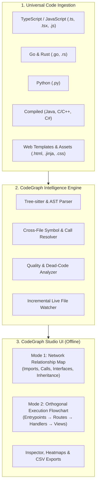

<p align="center">
  <br />
  <h1 align="center">✦ CodeGraph Studio ✦</h1>
  <p align="center">
    <strong>Universal Multi-Language Codebase Visualizer & Execution Flowchart Studio</strong>
  </p>
  <p align="center">
    <em>Crafted & Maintained by <strong><a href="https://github.com/kissuHQ">KissuHQ</a></strong> (Global Identity: <strong>PR</strong>)</em>
  </p>
  <p align="center">
    <a href="https://github.com/kissuHQ/CodeGraph_Studio/blob/main/LICENSE"></a>
    <a href="https://www.python.org/"></a>
    <a href="https://github.com/kissuHQ"></a>
    
    
    
  </p>
  <br />
</p>

---

## 🧭 Overview

**CodeGraph Studio** is a standalone, portable code intelligence and visual architecture studio. It parses codebases across multiple programming languages (**TypeScript, JavaScript, Go, Rust, Python, Java, C/C++, C#, PHP, Ruby**, and web stacks) and generates an interactive, hardware-accelerated dark studio directly in your browser.

Whether you are onboarding onto a massive unfamiliar repository, performing impact analysis, diagnosing circular dependencies, or tracing execution flows across microservices and templates, CodeGraph Studio renders your entire system with precision.



---

## ⚡ Prerequisites

> [!IMPORTANT]
> **CodeGraph CLI Required**: Make sure **`codegraph`** is installed on your system and available in your `PATH`.
>
> Verify via your terminal:
> ```bash
> codegraph --version
> ```
> CodeGraph Studio utilizes the `codegraph` CLI tool for Tree-sitter multi-language indexing, symbol cross-referencing, and graph database generation. *(If unindexed, CodeGraph Studio automatically runs initial indexing for you!)*

---

## 🌟 Key Features

### 🌐 Universal Multi-Language Support
* **Multi-Language by Default**: Seamlessly visualizes **TypeScript, JavaScript, Go, Rust, Python, Java, C/C++, C#, PHP, Ruby**, and more.
* **Deep Symbol Extraction**: Extracts and color-codes `classes`, `methods`, `functions`, `interfaces`, `structs`, `traits`, `types`, `enums`, `modules`, `properties`, and `constants`.
* **Zero-Config Fallback**: Includes a built-in standard-library AST fallback for Python codebases even without pre-indexing.

### 🎭 Dual Visualization Modes
1. **Network Mode**: Interactive force-directed relationship graph displaying containment, imports, function calls, class inheritance, interface implementation, and references.
2. **Flow Mode**: Step-by-step orthogonal branching execution flowchart (entry points &rarr; routes &rarr; service functions &rarr; templates/outputs) inspired by high-end workflow diagrams.

### 🌐 Full-Stack & Web Layer Awareness
* **Route Recognition**: Auto-detects endpoints and HTTP methods (`GET`, `POST`, `PUT`, `DELETE`).
* **Template Mapping**: Scans template hierarchies (`extends`, `include`, `blocks`), forms (`action`, `method`), and static asset dependencies (`.css`, `.js`).
* **Broken Link Detection**: Automatically warns about missing templates or unresolvable route endpoints.

### 📊 Code Quality & Architecture Metrics
* **Complexity & LOC**: Calculates cyclomatic complexity and line counts per symbol.
* **Hotspot Overlay**: Visualizes architectural hotspots and high-churn complexity centers.
* **Dead Code Detection**: Pinpoints orphan functions, unused interfaces, and unreferenced structs with one-click **CSV report export**.

### ⚡ 100% Offline & Zero External Python Dependencies
* Backend runs purely on Python standard libraries (`http.server`, `sqlite3`, `ast`, `hashlib`, `socket`).
* Frontend Cytoscape.js, Dagre, and layout engines are pre-bundled in `web/vendor/`—no internet connection required.

---

## 🚀 Quick Start

### 1. Visualize Current Directory
Navigate into any project directory and run:
```bash
python path/to/CodeGraph/codegraph.py
```
*(Or if you placed CodeGraph Studio inside the project, simply run `python codegraph.py`)*

### 2. Specify Any Target Project Path
Pass the path of any target repository:
```bash
python codegraph.py "C:\Users\Admin\Desktop\MyProject"
```

### 3. Windows 1-Click / Drag & Drop
* **Double-click** `run.bat` to analyze the current folder.
* **Drag and drop** any project folder directly onto `run.bat` to launch the visualizer immediately.

---

## 🛠️ CLI Options & Flags

```bash
python codegraph.py [target] [options]
```

| Flag | Description | Default |
|---|---|---|
| `target` | Path to the codebase directory to analyze | Current working directory |
| `-d`, `--path` | Alternative option to specify the target directory | `None` |
| `-p`, `--port` | Local port number to run the HTTP visualizer server on | `5050` (or next free port) |
| `--no-browser` | Start server without auto-opening the web browser | Opens browser automatically |
| `--reindex` | Force re-index with `codegraph` CLI on startup | `False` |

---

## ⌨️ Studio Keyboard Shortcuts

| Shortcut | Action |
|---|---|
| `1` | Switch to **Network Mode** (Calls, references, dependencies map) |
| `2` | Switch to **Flow Mode** (Orthogonal branching execution flowchart) |
| `-` / `+` or `[` / `]` | **Node Spacing Slider** (Expands dense clusters without camera zoom) |
| `F` | **Fit Camera** to entire canvas |
| `Ctrl + K` or `/` | **Global Search** (Find functions, classes, routes, files) |
| `B` | Toggle left filter sidebar |
| `Shift + P` | Toggle real-time FPS & latency performance monitor |
| `?` | Open keyboard shortcuts cheatsheet |

---

## 📂 Repository Structure

```
CodeGraph/
├── codegraph.py              # Universal CLI runner & server launcher
├── run.bat                   # Windows one-click & drag-and-drop launcher
├── README.md                 # Complete project documentation
├── LICENSE                   # Apache 2.0 open-source license
│
├── core/                     # Backend Intelligence & Server Engine
│   ├── __init__.py           # Package exports
│   ├── analyzer.py           # Multi-language graph parser & metrics engine
│   └── server.py             # Multi-threaded server & live multi-language watcher
│
└── web/                      # Frontend Studio UI (100% Offline)
    ├── index.html            # CodeGraph Studio web visualizer interface
    └── vendor/               # Bundled JavaScript graph libraries
        ├── cytoscape.min.js
        ├── dagre.min.js
        ├── cytoscape-dagre.js
        ├── cytoscape-fcose.js
        ├── cose-base.js
        └── layout-base.js
```

---

## 👨‍💻 Author & Maintainer

<table align="center">
  <tr>
    <td align="center">
      <a href="https://github.com/kissuHQ">
        <br />
        <sub><b>KissuHQ</b></sub>
      </a>
      <br />
      <sub>Global Identity: <b>PR</b></sub>
      <br />
      <sub>Lead Architect & Developer</sub>
    </td>
  </tr>
</table>

- **GitHub Profile**: [@kissuHQ](https://github.com/kissuHQ)
- **Official Repository**: [CodeGraph_Studio](https://github.com/kissuHQ/CodeGraph_Studio)

Contributions, feature ideas, and pull requests are warmly welcomed!

---

## 🤝 Contributing

1. Fork the Project (`https://github.com/kissuHQ/CodeGraph_Studio/fork`)
2. Create your Feature Branch (`git checkout -b feature/AmazingFeature`)
3. Commit your Changes (`git commit -m 'feat: add amazing feature'`)
4. Push to the Branch (`git push origin feature/AmazingFeature`)
5. Open a Pull Request

---

## 📄 License

Distributed under the **Apache License 2.0**. See the [`LICENSE`](file:///c:/Users/Admin/Desktop/CodeGraph/LICENSE) file for complete terms, conditions, and patent/trademark protections.
